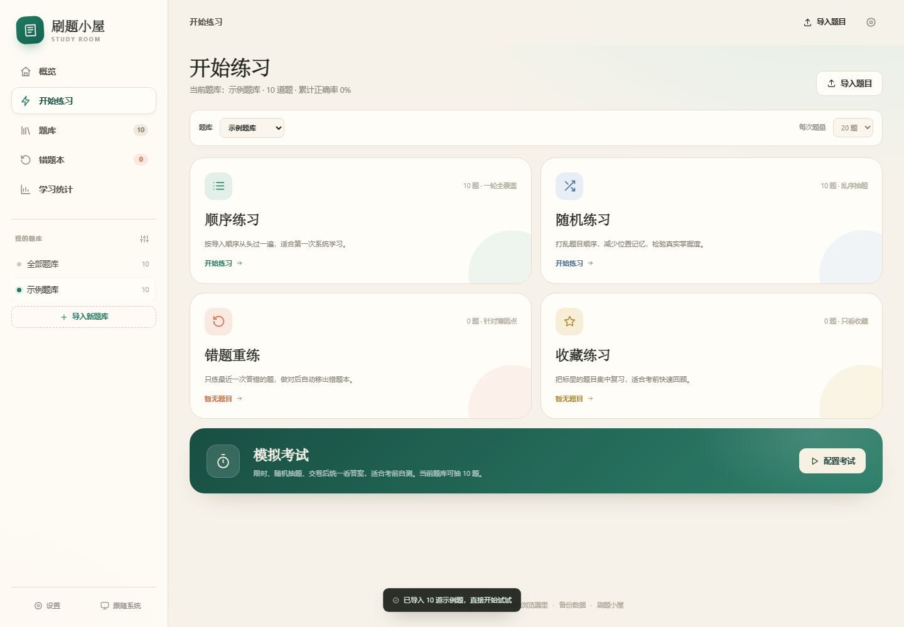

# 刷题小屋 · Quiz Shed

一个本地优先的刷题网页应用。把自己的题库导进来，就能按顺序刷、随机刷、重练错题、模拟考试，并查看学习统计。

无框架、无构建步骤、无后端依赖，双击 `index.html` 就能用。题库和练习记录只保存在当前浏览器的 `localStorage` 里，不会上传到任何服务器。



## 功能

- **多种导入方式**：JSON、CSV、TSV、结构化纯文本；支持选择文件、拖拽文件、直接粘贴。
- **自动识别**：识别题型、选项、答案、解析、标签和难度；无表头的表格也能尝试推断列。
- **去重导入**：默认按题干跳过重复题目；可导入到已有题库或新建题库。
- **四种练习模式**：顺序练习、随机练习、错题重练、收藏练习。
- **模拟考试**：随机抽题、限时作答、交卷后统一看答案，未作答按错误计分。
- **答后反馈**：选择题即时判分，填空题支持多个等价答案，答完显示正确答案与解析。
- **错题与收藏**：答错自动进入错题本；答对一次后自动移出；也可以手动收藏和标记掌握。
- **学习统计**：今日题量、连续学习、累计正确率、最近 14 天趋势、题型正确率和题库进度。
- **数据管理**：题目增删改查、题库重命名/删除、JSON 备份、CSV 导出与恢复。
- **使用体验**：明暗主题、响应式移动端布局、键盘快捷键、操作可撤销提示。

## 快速开始

### 方式一：直接打开

1. 下载或克隆本仓库。
2. 双击 `index.html`。
3. 点「导入题目」，或先点「载入示例题库」体验。

### 方式二：本地静态服务器

不是必需，但如果你希望用 `http://` 访问：

```bash
# 任选一种
python -m http.server 8080
npx serve .
```

然后打开 `http://localhost:8080`。

## 导入题库

### CSV / TSV

第一行是表头，推荐列顺序：

```csv
题目,类型,选项A,选项B,选项C,选项D,答案,解析
HTTP 默认端口是？,单选,80,443,8080,3306,A,HTTP 默认使用 80 端口。
下列属于可再生能源的是？,多选,太阳能,风能,煤炭,水能,A|B|D,煤炭属于不可再生能源。
声音可以在真空中传播。,判断,正确,错误,,,错误,声音传播需要介质。
我国现行宪法是______年颁布的。,填空,,,,,1982,1982 年 12 月 4 日通过。
```

- 表头支持中英文别名，例如「题目 / 题干 / question」「答案 / 正确答案 / answer」「选项A / A / optionA」。
- 多选题答案可用 `A,B`、`A|B`、`A/B` 等写法。
- 判断题答案可写 `正确 / 错误`、`对 / 错`、`T / F`、`true / false`。
- 填空题多个可接受答案用 `|` 分隔，例如 `H2O|H₂O`。
- 解析、标签、难度列可以省略。

仓库里有一份可直接导入的示例：[`examples/示例题库.csv`](examples/示例题库.csv)。

另有一份 **软考中级 · 软件设计师** 示范题库（24 道，覆盖计算机组成、数据结构、操作系统、数据库、网络、软件工程、面向对象、算法、知识产权和项目管理）：[`examples/软考中级-软件设计师示范题库.csv`](examples/软考中级-软件设计师示范题库.csv)。这些题按考试大纲自编，用于演示导入和刷题流程，不是历年真题。

如果只想按自己的内容出题，可以直接用 [`examples/题目模板.csv`](examples/题目模板.csv)：里面用 6 道题演示了单选、多选、判断、填空，以及标签、难度、解析的写法，把示例行替换成自己的题目即可。

导入时建议在弹窗里选择「新建题库」，题库名填「软考中级 · 软件设计师」，这样不会和示例题库混在一起。

### JSON

支持三种顶层结构：数组、`{ "questions": [...] }`、`{ "data": [...] }`。

```json
[
  {
    "题目": "HTTP 默认端口是？",
    "类型": "单选",
    "选项": { "A": "80", "B": "443", "C": "8080", "D": "3306" },
    "答案": "A",
    "解析": "HTTP 默认使用 80 端口。",
    "标签": ["网络"],
    "难度": 1
  },
  {
    "题目": "水的化学式是______。",
    "类型": "填空",
    "答案": "H2O|H₂O",
    "解析": "一个水分子由两个氢原子和一个氧原子构成。"
  }
]
```

也支持英文字段：`stem`、`type`、`options`、`answer`、`explanation`、`tags`、`difficulty`。

### 纯文本

每道题之间空一行。题干、选项、答案、解析各占一行：

```text
1. 中国的首都是哪座城市？
A. 北京
B. 上海
C. 广州
D. 深圳
答案：A
解析：北京是中华人民共和国的首都。

2. 声音可以在真空中传播。
答案：错误
解析：声音的传播需要介质。

3. 水的化学式是______。
答案：H2O|H₂O
```

- 题干前的 `1.`、`2、` 等序号会自动去掉。
- 选项支持 `A.`、`A、`、`A)` 等前缀。
- 判断题没有选项时，答案直接写「正确 / 错误」。
- 「答案：」这一行是必需的，否则该题会被跳过并提示错误。

## 快捷键

| 按键 | 作用 |
| --- | --- |
| `1`–`8` / `A`–`H` | 选择选项 |
| `Enter` | 提交答案 / 下一题 |
| `←` `→` | 上一题 / 下一题 |
| `F` | 标记本题 |
| `Esc` | 关闭弹窗或退出练习 |

## 数据与备份

- 数据保存在浏览器的 `localStorage`，键名为 `quiz-shed:v1`。
- 清理浏览器数据、换浏览器或换设备后，数据不会自动同步。
- 建议定期在「设置 → 导出数据」里导出 JSON 备份；换设备时用「恢复备份」导入。
- 全部数据都在本机，应用本身不发起任何网络请求。

## 项目结构

```text
quiz-shed/
├── index.html          # 页面骨架
├── styles.css          # 设计系统与响应式样式
├── app.js              # 状态、渲染、练习/考试、统计、导入导出
├── js/
│   └── import.js       # JSON / CSV / TSV / 纯文本解析器
├── examples/
│   ├── 示例题库.csv
│   ├── 题目模板.csv
│   └── 软考中级-软件设计师示范题库.csv
├── docs/
│   └── preview.png
├── LICENSE
└── README.md
```

## 技术说明

- 原生 HTML / CSS / JavaScript，无第三方运行时依赖。
- 使用 ES2020 语法和 CSS 自定义属性，支持现代 Chrome、Edge、Firefox、Safari。
- 数据层是一个可序列化的 `state` 对象，便于备份和迁移。

## License

[MIT](LICENSE)
